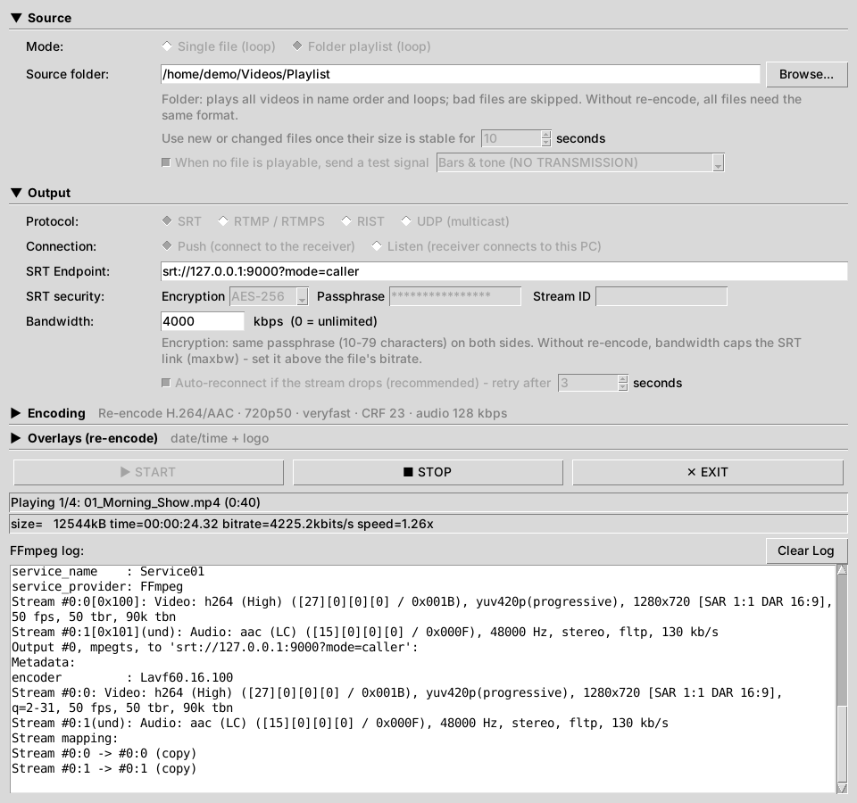
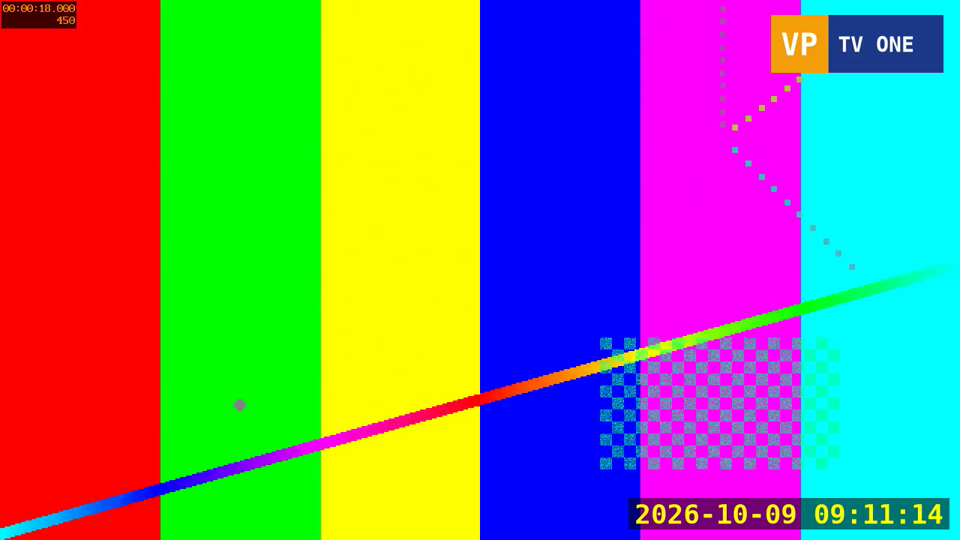

# Video Pusher

**Turn video files into a live stream — and receive it on the other side.**

Video Pusher is a desktop app that loops a video file, or plays a whole folder as a 24/7 playlist, and sends it out as a continuous live stream over **SRT**, **RIST**, **RTMP/RTMPS** or **UDP multicast**. Its companion, **Video Receiver**, receives those streams and plays, records or relays them.

Use them as a test-signal generator, a loop channel for a lobby screen or IPTV, a contribution feed into a decoder or media server, or to stream to YouTube and other platforms.

Both apps have a simple window (Python/Tkinter). [FFmpeg](https://ffmpeg.org/) does all the media work.

| Video Pusher (streaming a folder playlist) | Video Receiver (receiving and recording) |
|---|---|
|  |  |

<p align="center">
  <br>
  <em>What the receiver gets: the stream re-encoded to 720p50 with a live date/time and a station logo.</em>
</p>

---

## Contents

- [Features](#features)
- [Requirements](#requirements)
- [Installation](#installation)
- [Your first stream in five minutes](#your-first-stream-in-five-minutes)
- [How to…](#how-to)
- [The Video Pusher window](#the-video-pusher-window)
- [The Video Receiver window](#the-video-receiver-window)
- [Troubleshooting](#troubleshooting)
- [Building standalone executables](#building-standalone-executables)
- [Running the tests](#running-the-tests)
- [Project layout](#project-layout)
- [License](#license)

The complete description of every setting is in the **[User Guide](docs/USER_GUIDE.md)**. How the apps are built is described, with diagrams, in **[Architecture](docs/ARCHITECTURE.md)**.

---

## Features

**Video Pusher**

- **Single file or folder playlist**, looped forever. Files added to, replaced in or removed from the folder are picked up while streaming. A file is used only once it has finished copying.
- **One continuous stream:** the connection stays open across files and loops, so receivers see one unbroken stream.
- **Look-ahead checking:** the next file is checked while the current one plays. Broken or incompatible files are skipped, and the log says why.
- **Four protocols:**
  - **SRT** with AES-128/192/256 encryption and an optional stream ID.
  - **RIST** (Simple or Main profile) with AES encryption.
  - **RTMP/RTMPS** with a hidden stream key field.
  - **UDP multicast** with TTL, network card choice and constant-rate, paced sending.
- **Push or listen:** connect out to the receiver, or wait for the receiver to connect to you.
- **Copy or re-encode:**
  - Copy passes the streams through untouched, using very little CPU.
  - Re-encode uses live-tuned H.264/AAC, with a preset, quality (CRF), audio bitrate and a fixed output format from 1080p50 / 1080i50 down to 576i50 / 480i59.94 (true interlaced).
- **Overlays:** a live date/time and a logo, with position, colour, size and opacity. **Change them while streaming** with *Apply to live stream*: instant when your FFmpeg supports it, otherwise a pause of about 0.3 s. The receiver stays connected either way.
- **Test signal:** colour bars and tone (or black) with "NO TRANSMISSION" and a clock, sent whenever no file is playable. The stream never stops.
- **Auto-reconnect**, a bandwidth cap, live stats, and a log that stays small on 24/7 runs.
- **Tidy window:** settings sit in collapsible panels that show a one-line summary when closed.

**Video Receiver**

- **Receives SRT, RIST, RTMP and UDP multicast:** it listens for a sender, or pulls from one.
- **Five actions:** play, play + record, play + relay to multicast, record only, relay only.
- **Records** to `.ts` or crash-safe `.mp4`. Each new connection gets its own file, so nothing is ever overwritten.
- **Resilient:** a sender that stops, crashes or loses its network is noticed after a few seconds, and the receiver is ready for the sender's next connection. The log says what happened.
- **Security:** checks the SRT/RIST passphrase and rejects RTMP senders with the wrong stream key.

**Both apps**

- **Remember their settings.** Passphrases and stream keys are never saved, and are shown as `****` in the log.
- **No Python packages to install:** just Python and FFmpeg.

---

## Requirements

| What | Notes |
|---|---|
| **Python 3.9 or newer, with Tkinter** | Included with the installers from [python.org](https://www.python.org/downloads/). On Debian/Ubuntu: `sudo apt install python3-tk`. Not needed if you use a ready-built executable. |
| **FFmpeg, ffprobe, ffplay** | Put them in the `bin/` folder. ffplay is only needed by Video Receiver, for playback. See [bin/README.md](bin/README.md). |

Use a **"full" FFmpeg build**. It includes everything the apps can use: **libsrt** (SRT), **librist** (RIST), **libx264** (re-encoding), **freetype** (date/time and test-signal clock) and **libzmq** (instant overlay changes). Good sources:

- **Windows:** the *full* build from [gyan.dev](https://www.gyan.dev/ffmpeg/builds/) (`ffmpeg-release-full.7z`), or a GPL build from [BtbN](https://github.com/BtbN/FFmpeg-Builds/releases).
- **macOS:** [evermeet.cx](https://evermeet.cx/ffmpeg/), or `brew install ffmpeg`.
- **Linux:** [johnvansickle.com static builds](https://johnvansickle.com/ffmpeg/), BtbN, or your distribution's `ffmpeg` package.

The apps check your FFmpeg at Start. If something is missing, for example RIST support, they tell you what it is.

---

## Installation

```bash
git clone https://github.com/<your-account>/video-pusher.git
cd video-pusher
```

1. Copy `ffmpeg`, `ffprobe` and `ffplay` (`.exe` on Windows) into the `bin/` folder.
2. Start the apps:

```bash
python main.py        # Video Pusher
python receiver.py    # Video Receiver
```

On Windows you can also double-click `main.py` / `receiver.py`, or build the standalone `VideoPusher.exe` and `VideoReceiver.exe` (see [Building](#building-standalone-executables)). Each is a single file with ffmpeg, ffprobe and ffplay built in, and needs no Python.

---

## Your first stream in five minutes

This sends a video from Video Pusher to Video Receiver on the **same PC** over SRT. Once it works, run the receiver on another PC and replace `127.0.0.1` with the receiver's IP address.

**1. Start the receiver**

1. Open **Video Receiver**.
2. Leave **Protocol** on **SRT** and **Connection** on **Listen**. The address is `srt://0.0.0.0:9000?mode=listener`.
3. Choose **Live Playback Only**.
4. Click **▶ START LISTENING**. The status shows *Listening for SRT…*.

**2. Start the pusher**

1. Open **Video Pusher**.
2. In **Source**, leave **Mode** on *Single file (loop)*, click **Browse…** and pick a video file.
3. In **Output**, leave **Protocol** on **SRT** and **Connection** on **Push**. The endpoint is `srt://127.0.0.1:9000?mode=caller`.
4. Click **▶ START**.

After a few seconds, the receiver's status changes to *Receiving SRT stream*, a playback window opens, and the pusher's status shows *Looping: yourfile.mp4 (duration)*.

**3. Stop**

Click **■ STOP** in either app. If you stop the pusher, the receiver notices and goes back to listening for the next connection.

> **Tip:** if the file is not H.264/AAC (for example an old MPEG-2 or ProRes file), open **Encoding** and tick **Re-encode to H.264/AAC**.

---

## How to…

### …stream a folder as a 24/7 channel

1. **Source → Mode:** *Folder playlist (loop)*. Browse to the folder.
2. Tick **When no file is playable, send a test signal**. The stream then stays up even if the folder is empty or all files are still copying.
3. **Encoding:** tick **Re-encode** and pick an **Output format** (e.g. *1080i50* or *720p50*). Files of any format and resolution then play one after another in the same stream. (Without re-encoding, all files must have the same format, and files that differ are skipped.)
4. Keep **Auto-reconnect** on, then **START**.

Files play in name order (prefix them `01_`, `02_`, … to set the order). You can add, replace or delete files while it runs. New files join once they have been unchanged for 10 seconds, so files still copying are never played half-finished.

### …stream to YouTube, Facebook or another RTMP server

1. **Output → Protocol:** **RTMP / RTMPS**, **Connection:** **Push**.
2. **Endpoint:** the server URL *without* the key, e.g. `rtmp://a.rtmp.youtube.com/live2`.
3. **Stream key:** paste your key. It is hidden, never logged and never saved. If you paste a full URL that ends in the key, the app moves the key into this field for you.
4. **Encoding:** tick **Re-encode**, choose a progressive format such as *1080p25* or *720p50*, and set **Bandwidth** (e.g. `4500` kbps) to the platform's recommended bitrate.
5. **START**.

### …send an encrypted stream over the internet

Use **SRT** (or **RIST**) with encryption:

1. **Receiver:**
   1. Protocol **SRT**, Listen on `srt://0.0.0.0:9000?mode=listener`.
   2. Under **SRT security**, set **Encryption** to **AES-256** and enter a **Passphrase** of 10–79 characters.
   3. Open UDP port 9000 in the receiver's firewall and router.
2. **Pusher:**
   1. Protocol **SRT**, Push to `srt://<receiver's public IP>:9000?mode=caller`.
   2. Use the same **Encryption** and **Passphrase**.
3. Start the receiver first, then the pusher.

A sender with the wrong passphrase is refused and nothing is received. Passphrases are hidden, shown as `****` in the log, and never saved: you type them again after reopening the app.

### …have the receiver connect to the pusher (pusher behind a firewall)

Swap the roles:

1. **Pusher:** set **Connection** to **Listen**, e.g. `srt://0.0.0.0:9000?mode=listener`.
2. **Receiver:** set **Connection** to **Pull**, pulling from `srt://<pusher IP>:9000?mode=caller`. Then click **▶ START PULLING**.

The pusher keeps streaming while nobody is connected, so a receiver that connects joins live. The receiver keeps retrying every 3 seconds until the pusher is up. This works for SRT, RTMP and RIST. Each app fixes the address details (`mode=…`, RIST's `@`) to match its Connection setting.

### …multicast to receivers, IRDs or VLC on the local network

1. **Pusher:**
   1. Protocol **UDP (multicast)**, destination `udp://239.1.1.1:5000`.
   2. Set **TTL** (16 is fine; 1 keeps it on the local segment) and, on a PC with several network cards, the **Local NIC IP** to send from.
   3. For hardware decoders, set **Bandwidth** to get a constant, smoothly paced bitrate.
2. **Receiver:** Protocol **UDP (multicast)**, listen on `udp://239.1.1.1:5000`, **START LISTENING**.
3. **VLC:** open `udp://@239.1.1.1:5000`.

Any number of receivers can watch the same group. Multicast across switches needs **IGMP snooping** on the network. On Windows, allow the UDP port in the receiving PC's firewall.

### …add a clock and a logo, and change them while on air

1. **Encoding:** tick **Re-encode** (overlays need re-encoding).
2. **Overlays:**
   1. Tick **Date/time** and choose its format, position, colour and size.
   2. Tick **Logo**, browse to a PNG (transparency is kept), and choose its position, size and opacity.
3. **START**.
4. While streaming, change any overlay setting, even turning either one on or off, and press **Apply to live stream**.

With a "full" FFmpeg build (which has the `zmq` filter), the change appears on the next frame with no pause. Otherwise the file restarts from the same point with a pause of about 0.3 s. The receiver stays connected either way, and the log says which method was used.

### …record what arrives

1. **Receiver → Action:** **Save to File Only** (or **Live Play + Save to File** to watch at the same time).
2. Choose **.ts** or **.mp4** and the output file. MP4 is written so that it stays playable even if recording stops abruptly.
3. **START LISTENING**.

If the sender disconnects and comes back, the new connection is recorded to a new file with a timestamp in its name. Earlier recordings are never overwritten.

---

## The Video Pusher window


The settings are grouped into four panels. Click a panel's title to collapse or expand it. A collapsed panel shows a one-line summary instead, such as `SRT · push · srt://10.0.0.5:9000 · AES-256`.

| Panel | What it holds |
|---|---|
| **Source** | Single file or folder playlist, the file or folder, and (folder mode only) how long a new file must be unchanged before it is used, and the test signal. |
| **Output** | Protocol, Push/Listen, the address, protocol options (SRT encryption and stream ID, RTMP stream key, RIST profile/buffer/encryption, UDP TTL and network card), bandwidth, and auto-reconnect. |
| **Encoding** | Copy or re-encode, output format, x264 preset, quality (CRF) and audio bitrate. |
| **Overlays** | Date/time and logo settings, and **Apply to live stream**. |

Below the panels are **START / STOP / EXIT**, the status line (e.g. `Playing 2/4: 02_City_Timelapse.mp4 (0:40)`), the live stats from FFmpeg, and the log.

**Bandwidth** means slightly different things depending on the protocol and mode:

| Mode | Effect |
|---|---|
| Re-encode | The target bitrate for video plus audio. |
| SRT copy | Caps the link rate (`maxbw`). Set it about 25 % above the file's bitrate. |
| UDP | A constant, paced send rate. In copy mode, set it above the file's bitrate. |
| RTMP / RIST copy | Ignored. |

All settings are explained in the [User Guide](docs/USER_GUIDE.md#video-pusher).

## The Video Receiver window

| Setting | What it does |
|---|---|
| **Protocol** | SRT, RTMP, RIST or UDP (multicast). |
| **Connection** | **Listen** (the sender connects to this PC) or **Pull** (this PC connects to a sender that is listening). UDP always listens. |
| **Drop a silent sender after** | If no data arrives for this many seconds (default 5), the connection is closed and the receiver gets ready for the sender's next connection. |
| **Listen on / Pull from** | The address. Each protocol and direction remembers its own. |
| **Protocol options** | SRT encryption and stream ID, RTMP stream key (a sender with another key is rejected; leave it empty to accept any), RIST profile/buffer/encryption, UDP network card and source filter. |
| **Action** | Live Playback Only · Live Play + Save to File · Live Play + Multicast · Save to File Only · Multicast Only. |
| **Window size** | The ffplay window at 100 %, 50 % or 25 %. |
| **Save format / Output file** | `.ts` or `.mp4`, and where to record. |
| **Multicast target** | Where to relay the stream as UDP multicast: group IP, port and (optionally) the network card. |

All settings are explained in the [User Guide](docs/USER_GUIDE.md#video-receiver).

---

## Troubleshooting

| Symptom | What to check |
|---|---|
| `FFmpeg not found at …` | The FFmpeg files aren't in `bin/`, or are misnamed (`ffmpeg.exe` on Windows). |
| "this FFmpeg build can't send/receive …" | Your FFmpeg lacks that protocol (often RIST). Use a "full" build. |
| Receiver: nothing arrives | The receiver must listen on the address and port the pusher sends to. Check the firewall: UDP for SRT/RIST/multicast, TCP for RTMP. |
| SRT: "Incorrect passphrase", or nothing received | The passphrases differ, or encryption is on at one side only. |
| Receiver: "Rejected a sender that used the wrong stream key" | The pusher's stream key doesn't match the receiver's. Leave the receiver's key empty to accept any. |
| RTMP fails at once in copy mode | The source isn't H.264/AAC. Tick **Re-encode**. |
| Files skipped with "format differs" | The folder has mixed formats in copy mode. Tick **Re-encode**. |
| Playback starts a few seconds late | Normal for SRT, RIST and UDP: FFmpeg first analyses the incoming stream. |
| Overlay changes pause the picture briefly | Your FFmpeg has no `zmq` filter, so the file is restarted instead. Use a "full" build for instant changes. |
| Test signal shows no clock | Your FFmpeg can't draw text (no freetype), so a caption image is used. Use a "full" build. |
| Multicast works on one PC but not across the network | The switch needs IGMP snooping (or multicast enabled), a router needs multicast routing, and the TTL must be high enough. |

More in the [User Guide](docs/USER_GUIDE.md#troubleshooting).

---

## Building standalone executables

Install the build tools, put the FFmpeg binaries in `bin/`, and run the script for your platform:

```bash
pip install -r requirements-dev.txt

build.bat        # Windows
./build.sh       # macOS / Linux
```

This needs all three tools in `bin/` (`ffmpeg`, `ffprobe`, `ffplay`; `.exe` on Windows). Static builds are best, so the executables don't depend on libraries installed on the PC.

The result is two **single-file executables** in `dist/`, `VideoPusher` and `VideoReceiver` (`.exe` on Windows). Each has ffmpeg, ffprobe, ffplay and the `assets/` folder built in, so it runs on a PC with neither Python nor FFmpeg installed: copy the file over and double-click it. On start, the bundled tools are unpacked to a temporary folder, which takes a few seconds. The log shows where FFmpeg was found.

## Running the tests

```bash
pip install -r requirements-dev.txt
python -m pytest            # on Linux, `xvfb-run -a python -m pytest` also runs the window tests
```

Over 100 tests cover the FFmpeg commands the apps build and real end-to-end streaming between Video Pusher and Video Receiver:

- SRT, RTMP, RIST and UDP multicast;
- encryption and stream keys;
- folder playlists and the test signal;
- live overlay changes;
- recovery from a sender that stops or freezes.

Tests that need FFmpeg (in `bin/` or on your `PATH`), a protocol your FFmpeg lacks, or a display are skipped automatically. GitHub Actions runs the suite on every push.

## Project layout

```
main.py              Video Pusher (also holds the shared helpers)
receiver.py          Video Receiver
assets/              bundled font and "NO TRANSMISSION" caption image
bin/                 put ffmpeg / ffprobe / ffplay here (not in Git)
docs/USER_GUIDE.md   full description of every setting
docs/ARCHITECTURE.md architecture diagrams and design notes
docs/diagrams/       Graphviz sources of the architecture diagrams
docs/images/         screenshots and rendered diagrams
tests/               pytest suite
build.bat, build.sh  PyInstaller builds for Windows and macOS/Linux
CHANGELOG.md         version history
```

---

## License

Video Pusher and Video Receiver are free software under the **GNU General Public License v2.0 or later** (GPL-2.0-or-later), the same terms as FFmpeg's GPL builds. See [LICENSE](LICENSE). You may use, modify and redistribute them, including commercially, provided that distributed copies or modified versions are also released under the GPL with their source code.

**Bundled font:** `assets/DejaVuSansMono-Bold.ttf` is from the DejaVu fonts (Bitstream Vera license, with DejaVu changes in the public domain). Its license is in [assets/LICENSE-DejaVu.txt](assets/LICENSE-DejaVu.txt).

**FFmpeg** is a separate project with its own license (LGPL or GPL depending on the build; GPL when built with libx264). It is not stored in this repository. If you distribute an executable with FFmpeg built in, you must also comply with that build's license. This includes stating which build is included and making its source available, for example with a link to the exact release. See <https://ffmpeg.org/legal.html>.

Copyright © 2026 Desmond Kee.
