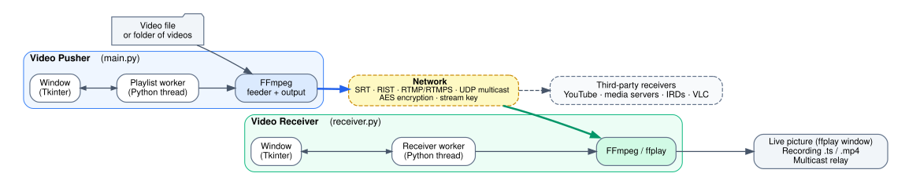
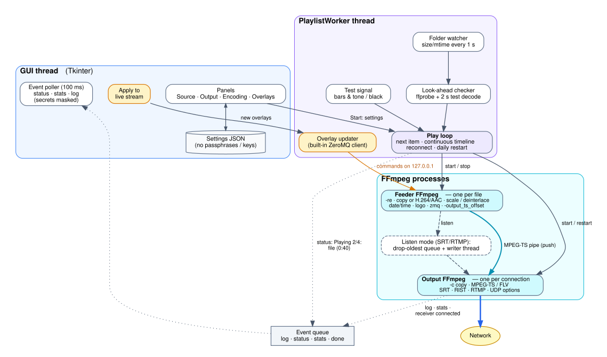
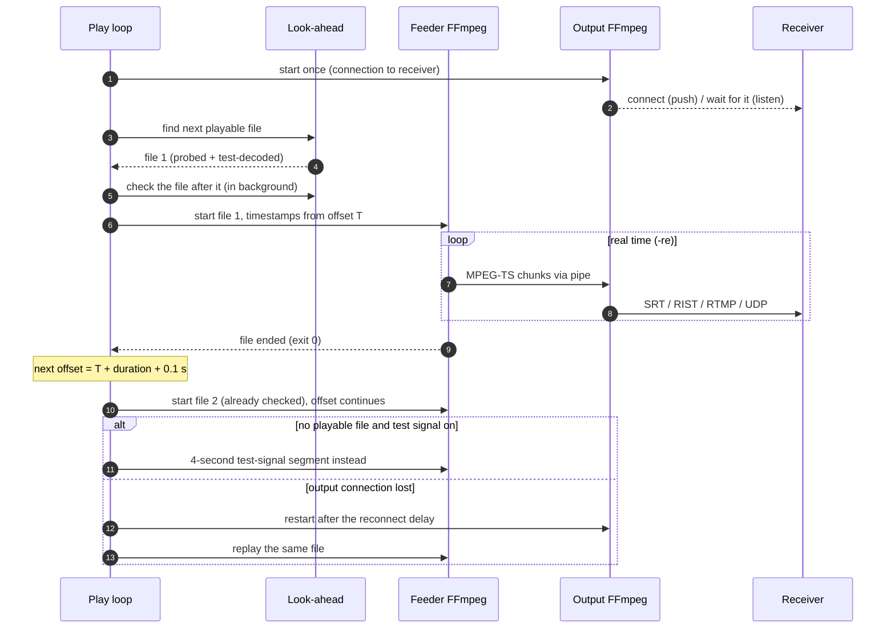
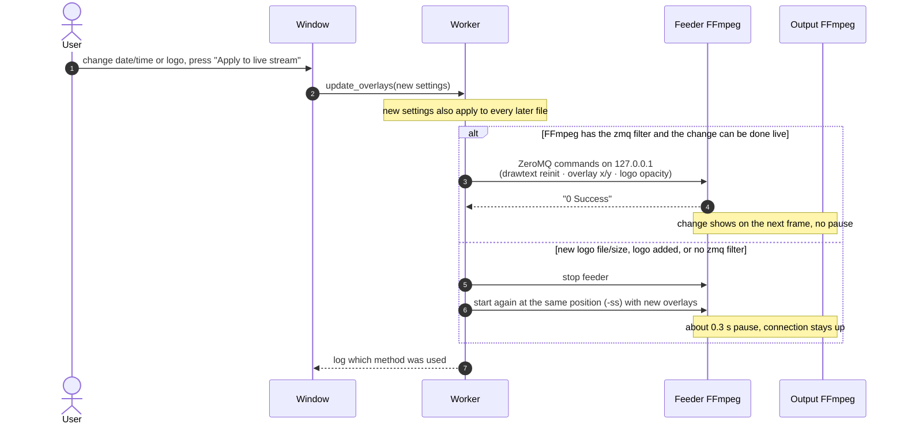
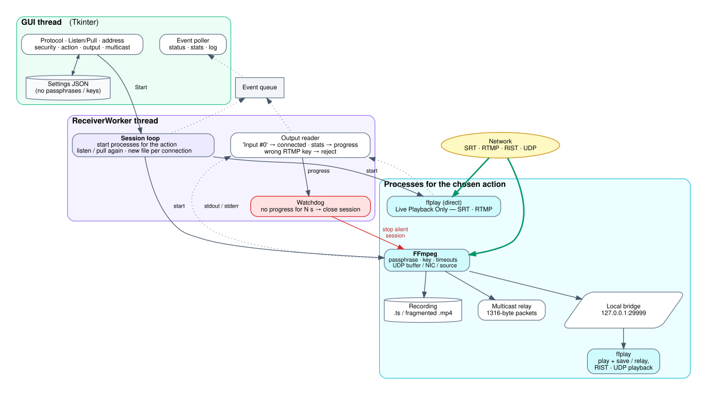
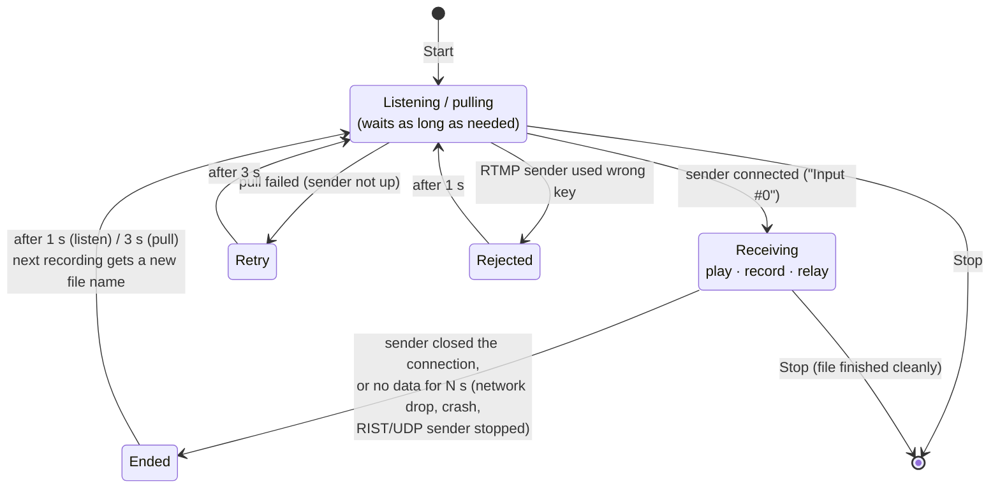

# Architecture

How Video Pusher and Video Receiver are built.

- **Structure diagrams (1, 2, 5)** are drawn with [Graphviz](https://graphviz.org/). Their sources are in [`docs/diagrams/`](diagrams/), and there are SVG and PNG versions in [`docs/images/`](images/).
- **Sequence and state diagrams (3, 4, 6)** are written in [Mermaid](https://mermaid.js.org/), which GitHub draws directly from this file. PNG copies are in `docs/images/` too, for slides and other documents.

To redraw the Graphviz diagrams after a change, run `dot -Tsvg x.dot -o ../images/architecture-x.svg` and `dot -Tpng -Gdpi=150 x.dot -o ../images/architecture-x.png`, from `docs/diagrams/`.

- [1. System overview](#1-system-overview)
- [2. Video Pusher](#2-video-pusher)
- [3. Video Pusher: playing one file](#3-video-pusher-playing-one-file)
- [4. Video Pusher: changing overlays while streaming](#4-video-pusher-changing-overlays-while-streaming)
- [5. Video Receiver](#5-video-receiver)
- [6. Video Receiver: connection life cycle](#6-video-receiver-connection-life-cycle)
- [Design notes](#design-notes)

---

## 1. System overview

Both apps are thin Python/Tkinter front ends. All media work is done by FFmpeg processes that the apps start, feed and watch.

Source: [`diagrams/overview.dot`](diagrams/overview.dot) (Graphviz) · PNG: [`images/architecture-overview.png`](images/architecture-overview.png)

Either side can be the one that waits for the other (**Push → Listen**, or **Listen → Pull**). UDP has no connection: the pusher sends, and any number of receivers join the multicast group.

---

## 2. Video Pusher

The window never blocks: everything slow runs in a worker thread, which reports back through an event queue that the window polls every 100 ms. The worker keeps **one long-lived output FFmpeg** for the connection and starts a **short-lived feeder FFmpeg for each file**, so the stream stays continuous across files and loops.

Source: [`diagrams/pusher.dot`](diagrams/pusher.dot) (Graphviz) · PNG: [`images/architecture-pusher.png`](images/architecture-pusher.png)

| Part | Role |
|---|---|
| **Feeder FFmpeg** | Reads one file in real time (`-re`) and encodes it if needed: scaling, deinterlacing, interlaced encoding, the date/time and the logo. Its timestamps are shifted (`-output_ts_offset`) so that each file continues exactly where the previous one ended. |
| **Output FFmpeg** | Copies the MPEG-TS it receives into the chosen protocol and keeps the connection open for the whole playlist. It holds the protocol options: SRT passphrase / `maxbw` / stream ID, RIST profile and encryption, RTMP `-listen` and timeout, UDP TTL, packet size, mux rate and pacing. |
| **Look-ahead checker** | While a file plays, it finds and test-decodes the next playable file, so a broken file is skipped before it is due. |
| **Folder watcher** | Records file sizes every second, so files that are still copying are never used. |
| **Drop-oldest queue** | Only used in listen mode. While no receiver is connected, the playlist keeps running in real time and old data is dropped, so a receiver that connects joins live rather than getting a backlog. |
| **Single-file mode** | Uses the same pipeline as a playlist of one. A simpler one-process player (`SingleFileWorker`) is the fallback when ffprobe is missing. |

---

## 3. Video Pusher: playing one file

---

## 4. Video Pusher: changing overlays while streaming

---

## 5. Video Receiver

The receiver repeats one *session* after another. Each session starts the processes for the chosen action, watches them, and when the sender stops or goes silent, it starts listening (or pulling) again.

Source: [`diagrams/receiver.dot`](diagrams/receiver.dot) (Graphviz) · PNG: [`images/architecture-receiver.png`](images/architecture-receiver.png)

| Part | Role |
|---|---|
| **Session loop** | Starts the processes for the chosen action. When they end, it waits 1 s (listen) or 3 s (pull) and starts again. Each new connection records to a new, timestamped file. |
| **FFmpeg** | Receives the stream and copies it, without re-encoding, to a file, a multicast relay and/or the local bridge for ffplay. |
| **ffplay** | Shows the picture. For SRT and RTMP playback it receives the stream itself. For everything else it plays the local bridge. |
| **Output reader** | Turns FFmpeg's output into status, stats and log lines (with secrets masked). It notices the connection ("Input #0") and rejects an RTMP sender that uses the wrong stream key. |
| **Watchdog** | Follows FFmpeg's output time. If no new data arrives for the *silent-sender* time (default 5 s), it closes the session so the receiver is ready for the sender's next connection. FFmpeg's own timeouts do the same job for SRT and RTMP; the watchdog also covers RIST and UDP. |

---

## 6. Video Receiver: connection life cycle

---

## Design notes

- **FFmpeg does the media, Python does the control.** The apps build FFmpeg command lines, feed or pipe data between processes, and read FFmpeg's output. No media is decoded in Python, so CPU use is mostly FFmpeg's.
- **One connection per stream.** The pusher's split into feeder and output processes means files, loops, the test signal and overlay changes never reconnect the receiver. Only a lost connection or the daily restart (which avoids the MPEG-TS timestamp wrap-around) does.
- **Never trust the network to say goodbye.** The receiver relies on timeouts and the watchdog, not on the sender closing cleanly. The pusher's RTMP output has an I/O timeout, and auto-reconnect handles the rest.
- **Threads talk through queues.** Worker threads never touch Tkinter. They post events that the GUI thread picks up, so the window stays responsive during long FFmpeg operations.
- **Secrets stay in memory.** Passphrases and stream keys live only in hidden fields and in the worker's settings. Every line shown is passed through a masking step, and the settings files never contain them.
- **No Python dependencies.** Only the standard library is used, including a small built-in ZeroMQ client for live overlay commands. PyInstaller bundles the app, FFmpeg, ffprobe, ffplay and the assets into one file.

### Source map

| File / class | Contains |
|---|---|
| `main.py` · `VideoPusherApp`, `CollapsiblePanel` | Pusher window and panels |
| `main.py` · `PlaylistWorker` | Feeder/output pipeline, look-ahead, folder watcher, test signal, listen-mode queue, live overlays |
| `main.py` · `SingleFileWorker` | Simple one-process fallback player |
| `main.py` · `PersistMixin`, `SecurityMixin` | Saved settings; SRT/RTMP security fields shared by both apps |
| `main.py` · `ZmqRequester` | Minimal ZeroMQ client for live overlay commands |
| `main.py` · helpers | Command builders (`output_args`, `video_graph`, `slate_cmd`, …), address rules, secret masking |
| `receiver.py` · `ReceiverApp` | Receiver window |
| `receiver.py` · `ReceiverWorker` | Session loop, output reader, watchdog, RTMP key check |
| `receiver.py` · `build_commands` | FFmpeg / ffplay commands for each action |
