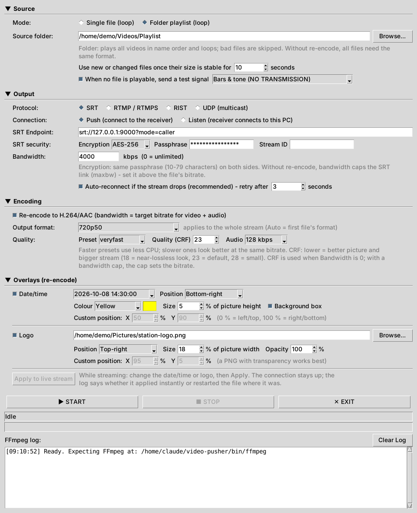
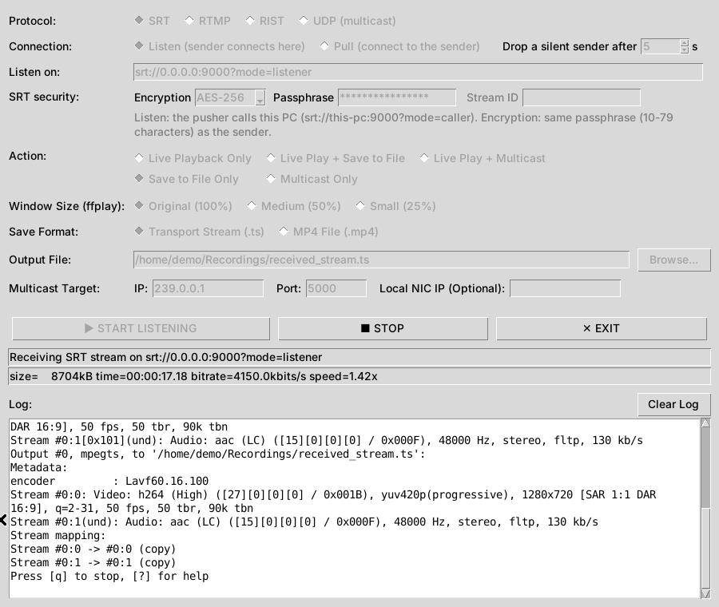

# User Guide

This guide describes every setting of **Video Pusher** and **Video Receiver** and how they behave. For installation and step-by-step recipes, see the [README](../README.md).

- [Video Pusher](#video-pusher)
  - [Source panel](#source-panel)
  - [Output panel](#output-panel)
  - [Encoding panel](#encoding-panel)
  - [Overlays panel](#overlays-panel)
  - [Folder playlist in detail](#folder-playlist-in-detail)
  - [Test signal](#test-signal)
- [Video Receiver](#video-receiver)
- [Push and listen](#push-and-listen)
- [Security](#security)
- [RIST notes](#rist-notes)
- [UDP and multicast](#udp-and-multicast)
- [Saved settings](#saved-settings)
- [Troubleshooting](#troubleshooting)

---

## Video Pusher

The window has four panels: **Source**, **Output**, **Encoding** and **Overlays**. Click a panel's title to collapse or expand it. A collapsed panel shows a one-line summary of its settings. The window grows when an opened panel needs room, and the app remembers which panels are open.

Under the panels:

- **START / STOP / EXIT** buttons.
- The **status line**, e.g. `Playing 2/4: 02_City_Timelapse.mp4 (0:40)` or `Looping: promo.mp4 (2:30) - pass 3`. In listen mode it adds "waiting for a receiver" until one connects.
- The **stats line**: FFmpeg's live size, time, bitrate and speed.
- The **log**, which keeps the last 2,000 lines, with a **Clear Log** button.

While streaming, most controls are locked. Changes to other settings take effect at the next Start. The overlays are the exception: they can be changed live (see [Apply to live stream](#apply-to-live-stream)).

### Source panel

| Setting | Notes |
|---|---|
| **Mode** | **Single file (loop)** loops one file forever. **Folder playlist (loop)** plays every video in the folder in name order (`.mp4 .m4v .mov .mkv .ts .m2ts .mts .mxf .avi .flv .webm .mpg .mpeg .wmv`), then starts again. Each mode remembers its own path. Both modes keep one continuous connection open across files and loops. |
| **Use new or changed files once their size is stable for** *(folder)* | A new or changed file is only used once its size and modification time have been unchanged for this many seconds (default 10, range 2–600). Files still being copied in are therefore never played half-finished. Raise it for slow network copies that may pause. |
| **When no file is playable, send a test signal** *(folder)* | Sends **Bars & tone** or **Black & silence** with a "NO TRANSMISSION" caption instead of pausing the stream. With this ticked you can also press Start on an empty folder. See [Test signal](#test-signal). |

### Output panel

| Setting | Notes |
|---|---|
| **Protocol** | **SRT** (MPEG-TS), **RTMP / RTMPS** (FLV), **RIST** (MPEG-TS) or **UDP (multicast)** (MPEG-TS). At Start, the app checks that your FFmpeg build supports the protocol, and says what is missing if it doesn't. |
| **Connection** | **Push:** the pusher connects to a receiver that is listening (the usual setup). **Listen:** the pusher waits for the receiver to connect to it; see [Push and listen](#push-and-listen). UDP has no connection, so it is always Push. |
| **Endpoint / Listen on / UDP destination** | The address. Each protocol and direction remembers its own. The app fixes it to match the Connection setting: SRT gets `mode=caller` or `mode=listener`, and RIST gets or loses the `@` listen marker. It logs what it changed. Examples: `srt://192.168.1.50:9000?mode=caller`, `rtmp://a.rtmp.youtube.com/live2`, `rist://192.168.1.50:5000`, `udp://239.1.1.1:5000`. |
| **SRT security** | **Encryption:** Off, AES-128, AES-192 or AES-256. **Passphrase:** 10–79 characters, the same on both sides. **Stream ID** *(push only, optional)*: sent to SRT servers that use it to pick the stream or check access (SRS, MediaMTX, Haivision, cloud services), e.g. `#!::r=live/cam1,m=publish`. A `passphrase=` typed into the address is moved into the Passphrase field. |
| **RTMP stream key** | *Push only.* The key your platform or server gives you, hidden as you type (**Show** reveals it). It is added to the address when sending. If you paste a full URL that ends in the key, the key is moved into this field at Start. It isn't used in listen mode, because FFmpeg's RTMP server can't check which key a player asks for. |
| **RIST options** | **Profile:** Main (default; supports encryption) or Simple; the receiver must use the same profile. **Buffer:** the retransmission window, 50–30000 ms (default 1000); raise it for long or lossy links, at the cost of latency. **Encryption** *(Main only)*: AES-128 or AES-256 with a passphrase. |
| **UDP options** | **TTL:** how many routers the multicast may cross (1–255, default 16; 1 = local segment only). **Local NIC IP** *(optional)*: the network card to send from, on a PC with several. |
| **Bandwidth (kbps)** | `0` = unlimited. **Re-encode:** the total target bitrate; the audio bitrate comes out of it and the rest goes to video. **SRT copy mode:** caps the link (`maxbw`); set it about 25 % above the file's bitrate to leave room for retransmissions. **UDP:** a constant mux rate (padded with null packets), sent with smooth pacing, which hardware decoders prefer. In copy mode it is exactly this rate, so set it above the files' bitrate; when re-encoding, 15 % is added for TS overhead. **RTMP and RIST copy mode:** ignored. |
| **Auto-reconnect … retry after** | When the stream drops, wait this many seconds (1–3600, default 3) and reconnect. The file that was playing restarts. RTMP pushes also give up after 10 s if the receiver stops accepting data without closing the connection, so auto-reconnect can take over. |

Passphrases and stream keys are hidden, shown as `****` everywhere in the log (FFmpeg's own messages included), and never saved.

### Encoding panel

| Setting | Notes |
|---|---|
| **Re-encode to H.264/AAC** | Off = **copy**: streams are passed through untouched, using little CPU. On = live-tuned x264 (`zerolatency`, keyframe every 2 s) and AAC. Re-encoding is needed when the source isn't H.264/AAC and you use RTMP, to set a bitrate, to fix the output format, to mix formats in a folder, or to use overlays. |
| **Output format** | **Auto** takes the first file's resolution and frame rate. A fixed format converts every file: 1080p25, 1080i50, 1080p50, 1080p29.97, 1080i59.94, 1080p59.94, 720p50, 720p59.94, 576i50 or 480i59.94. Interlaced formats are encoded as true top-field-first interlaced video; SD formats are 16:9 anamorphic. Use a progressive format for web platforms. In copy mode it only sets the test signal's format before the first file plays. |
| **Preset** | x264 speed/quality trade-off, from `ultrafast` to `medium` (default `veryfast`). Slower presets look better at the same bitrate but need more CPU. If the stats show `speed` below 1x, choose a faster one. |
| **Quality (CRF)** | 16–35, default 23. Lower = better picture and a bigger stream (18 looks near-lossless, 28 is small). It is used when Bandwidth is 0; with a bandwidth cap, the cap sets the bitrate. |
| **Audio** | AAC bitrate, 64–320 kbps (default 128). |

### Overlays panel

Overlays need **Re-encode**. They are drawn at the output size and before interlacing, so they look the same whatever the source. They are not shown on the test signal, which has its own clock.

| Setting | Notes |
|---|---|
| **Date/time** | The PC's date and running clock, burned into the picture. **Format:** `2026-10-08 14:30:00`, `08/10/2026 14:30:00` or `14:30:00`. **Position:** top/middle/bottom × left/centre/right, or **Custom** X/Y (0 % = left/top edge, 100 % = right/bottom edge). **Colour:** white, yellow, black, red, green, blue, cyan, magenta, orange, grey, or **Custom…** for any colour. **Size:** 2–20 % of the picture height. **Background box:** a translucent box behind the text; without it the text gets an outline. The box or outline is black behind light colours and white behind dark ones. Needs an FFmpeg that can draw text (freetype). |
| **Logo** | An image: PNG (transparency kept), JPG, BMP or WebP. **Position:** as for the date/time. **Size:** 2–60 % of the picture width. **Opacity:** 10–100 %. It is drawn on top of the date/time if they overlap. |

#### Apply to live stream

While streaming, the overlay controls stay usable. Change anything, including turning the date/time or the logo on or off, and press **Apply to live stream**. The receiver stays connected in either of these two cases:

- **Instant (no pause):** if your FFmpeg has the `zmq` filter (built with libzmq, e.g. the gyan.dev "full" builds), the change is sent to the running FFmpeg and shows on the next frame. This covers date/time on/off, format, position, colour, size and box, and logo on/off, position and opacity.
- **Restart from the same point (about 0.3 s pause):** this is used for a different logo file or logo size, for adding a logo that wasn't there at Start, or when your FFmpeg has no `zmq` filter. The file playing is restarted where it was, with the new settings.

The log says which method was used. The command channel listens on 127.0.0.1 only, on a random port per file.

### Folder playlist in detail

- **How it plays:** each file is played by a short-lived "feeder" FFmpeg that writes into one long-lived output FFmpeg. Timestamps carry on from file to file, so receivers see one continuous stream. Single-file mode works the same way, as a playlist of one.
- **New files** join once they have been unchanged for the stable time. Until then, the log shows "Not ready yet: … still changing". Files already in the folder at Start are ready immediately if they haven't been modified recently. A file's name sets its place: if it sorts after the current file it plays in this pass, otherwise in the next loop.
- **Deleted files** drop out at the next folder scan. If the file lined up next is deleted or replaced, or fails as soon as it opens, the app switches straight to another file that has already been checked, so the stream doesn't pause.
- **Checking:** before a file plays, it is probed with ffprobe and its first 2 seconds are test-decoded. Files that fail are skipped, and so is a file that fails partway through. A skipped file is tried again once it changes on disk.
- **Copy mode:** every file must match the first playable file's codec, resolution, frame rate and audio layout. Files that differ are skipped, and the log suggests re-encoding. For RTMP, files must also be H.264/AAC.
- **Re-encode mode:** any mix of formats works. Files without audio get a silent stereo track.
- **Nothing playable:** the app keeps checking. Without the test signal, the connection stays open but sends nothing; receivers freeze, and RTMP servers may disconnect.
- **Daily restart:** the output connection is restarted once every 24 hours, at a file boundary, to stay clear of the MPEG-TS timestamp wrap-around. Receivers see a brief reconnect once a day.

### Test signal

When the test signal is ticked and no file is playable, the app sends it in 4-second segments, re-checking the folder between them. As soon as a file is ready, it takes over on the same connection with no gap.

- **Bars & tone:** SMPTE HD colour bars (SMPTE bars for SD) and a 1 kHz tone at −18 dBFS. **Black & silence:** a black picture and silence.
- **Caption:** "NO TRANSMISSION" plus a live date and time, in the bundled DejaVu Sans Mono font. If FFmpeg can't draw text, the bundled caption image is used instead (no clock). If a style fails while running, the app falls back to the next one.
- **Format:** always matches the stream, so receivers see no change.
- **Over RIST**, the test signal is sent at a constant 2 Mbit/s with padding, because RIST receivers drop very low-bitrate streams.

---

## Video Receiver

| Setting | Notes |
|---|---|
| **Protocol** | SRT, RTMP, RIST or UDP (multicast). |
| **Connection** | **Listen:** the sender connects to this PC. **Pull:** this PC connects to a sender that is listening (the Start button then reads **START PULLING**). UDP always listens. |
| **Drop a silent sender after** | 2–120 s (default 5). See [When the sender stops](#when-the-sender-stops). |
| **Listen on / Pull from** | The address, remembered per protocol and direction. Examples: `srt://0.0.0.0:9000?mode=listener`, `rtmp://0.0.0.0:1935/live`, `rist://@0.0.0.0:5000`, `udp://239.1.1.1:5000`. |
| **SRT security** | **Encryption** and **Passphrase:** must match the sender. **Stream ID** *(pull only)*. |
| **RTMP stream key** | **Listen:** senders publishing with another key are rejected at once, and nothing of them is recorded; leave it empty to accept any. **Pull:** added to the address. |
| **RIST options** | Profile, buffer and encryption: must match the sender. |
| **UDP options** | **Local NIC IP:** the network card to receive on. **Only from source IP:** accept the multicast group from one sender only (source-specific multicast). |
| **Action** | See below. |
| **Window size** | The ffplay window: 100 %, 50 % or 25 %. |
| **Save format / Output file** | **.ts**, or **.mp4** (fragmented, so it stays playable even if recording stops abruptly). |
| **Multicast target** | IP, port and (optionally) the local network card for relaying. A relay into the same group the receiver is listening to is refused, because it would loop. |

**Actions**

| Action | What happens |
|---|---|
| **Live Playback Only** | ffplay plays the stream. For RIST and UDP, FFmpeg receives the stream and feeds ffplay through a local port, so the receiver can tell when the sender stops. |
| **Live Play + Save to File** | FFmpeg receives and records, and feeds ffplay through a local port (127.0.0.1:29999). |
| **Live Play + Multicast** | As above, but relays to UDP multicast instead of recording. |
| **Save to File Only** | Records only. |
| **Multicast Only** | Relays as MPEG-TS over UDP (whole 1316-byte datagrams) to the multicast target. |

#### When the sender stops

- A sender that **closes the connection properly** ends the stream at once.
- A sender that **disappears without closing it** (network drop, crash, PC frozen or switched off), or any **RIST** sender (RIST never reports a sender leaving), is dropped after **Drop a silent sender after** seconds without data. The log says "No data from the sender for 5 s – closing the connection", followed by "Stream ended (no data from the sender for 5 s)".

Either way, the receiver then listens (or pulls) again, ready for the sender's next connection. Waiting for a sender to connect is never cut short.

FFmpeg's own timeouts handle SRT and RTMP. A watchdog that follows the stream's progress is the backstop for every protocol. Raise the time only if a sender legitimately pauses for longer.

#### Other behaviour

- **A new file for each connection:** the first connection records to the chosen file. Later ones get a timestamp in the name (e.g. `received_stream_20261008-013000.ts`), so earlier recordings are never overwritten.
- **RIST** rides through short drops: if the sender comes back within the silent-sender time, the same recording carries on.
- **Pull mode:** if the sender isn't up yet, the receiver retries every 3 seconds. It logs the first failure once, then a reminder every 10 attempts.
- **Start-up delay:** playback starts a few seconds after connecting for SRT, RIST and UDP, while FFmpeg analyses the stream. RTMP starts almost at once.
- **Stop:** FFmpeg is asked to finish the file cleanly. If it doesn't respond, it is stopped firmly after a couple of seconds, and the recording up to that point is kept.

---

## Push and listen

Either side can be the one that waits. Set the two apps' **Connection** to opposite roles:

| Protocol | Pusher **Push** → Receiver **Listen** | Pusher **Listen** → Receiver **Pull** |
|---|---|---|
| SRT | Receiver listens on `srt://0.0.0.0:9000?mode=listener`; pusher sends to `srt://receiver-ip:9000?mode=caller` | Pusher listens on `srt://0.0.0.0:9000?mode=listener`; receiver pulls `srt://pusher-ip:9000?mode=caller` |
| RTMP | Receiver is the RTMP server on `rtmp://0.0.0.0:1935/live`; pusher sends to `rtmp://receiver-ip:1935/live` with the same stream key | Pusher is the RTMP server on `rtmp://0.0.0.0:1935/live`; receiver plays `rtmp://pusher-ip:1935/live` |
| RIST | Receiver listens on `rist://@0.0.0.0:5000`; pusher sends to `rist://receiver-ip:5000` | Pusher listens on `rist://@0.0.0.0:5000`; receiver pulls `rist://pusher-ip:5000` (Main profile only) |
| UDP | Pusher sends to `udp://239.1.1.1:5000`; receivers join `udp://239.1.1.1:5000` | — |

- **SRT and RTMP listen:** the pusher waits for a receiver, and the status shows "waiting for a receiver". Meanwhile the stream keeps running in real time, so a receiver that connects joins live. When the receiver leaves, the pusher listens again. One receiver at a time.
- **RIST listen:** the pusher streams all the time; receivers can connect and reconnect whenever they like.
- **Firewalls:** the side that listens must accept incoming connections on its port: UDP for SRT and RIST (RIST also uses the port above), TCP for RTMP.
- Neither app can *listen* for RTMPS, which needs a server certificate. Pushing to and pulling from RTMPS servers works.

## Security

| Protocol | Push → Listen | Listen → Pull |
|---|---|---|
| SRT | Same passphrase on both apps; a sender with the wrong one is refused | Same: a receiver with the wrong passphrase is refused |
| RIST | Same profile, AES size and passphrase | Same |
| RTMP | The receiver checks the stream key and cuts off a sender that uses another key | Not protected: FFmpeg's RTMP server lets any player in. Use SRT or RIST encryption instead. |
| UDP | No protection: use it only on a network you control | — |

RTMP itself is not encrypted; a stream key only controls who may publish. For encryption over the internet, use SRT or RIST with a passphrase, or push to an `rtmps://` server.

## RIST notes

- **Use an even port.** RIST sends control traffic on the port above (port + 1). The app warns about odd ports.
- **Encryption** needs the same passphrase and AES size at both ends. With a wrong passphrase, nothing is received.
- **Low bitrates:** RIST receivers drop streams below roughly 0.5–1 Mbit/s. Normal programme content is well above that. A very low-bitrate file (e.g. a still picture) may not get through in copy mode, so tick **Re-encode** for those.

## UDP and multicast

- **Pusher:** sends MPEG-TS to a multicast group (`udp://239.x.x.x:port`) or to one receiver's IP. Datagrams always carry 7 TS packets (1316 bytes). Set **Bandwidth** for a constant, smoothly paced rate.
- **Receiver:** joins the group. For a stream sent to this PC's own IP, use `udp://0.0.0.0:port`. A large receive buffer (about 9 MB) rides out short CPU spikes, and other programs on the same PC (e.g. VLC with `udp://@239.1.1.1:5000`) can watch the same group at the same time.
- **Networks:** multicast across switches needs IGMP snooping (or multicast enabled), and across routers it needs multicast routing and a high enough TTL. On Windows, allow the UDP port in the receiving PC's firewall. There is no encryption or retransmission, so use UDP on a local network you control.

## Saved settings

Both apps save their settings when you press Start and when you close them, and restore them at the next launch. This includes each protocol's address and, in the pusher, the paths for each mode and which panels are open.

| System | Location |
|---|---|
| Windows | `%APPDATA%\VideoPusher\` |
| macOS | `~/Library/Application Support/VideoPusher/` |
| Linux | `~/.config/VideoPusher/` |

The files are `pusher-settings.json` and `receiver-settings.json`.

- **Never saved:** SRT and RIST passphrases and RTMP stream keys, even when typed into an address. Enter them again after reopening. The encryption choice and the SRT stream ID are saved.
- **Resetting:** to go back to the defaults, close the app and delete its file.
- **Outdated values:** a saved value that is no longer valid is ignored, and the default is used.

## Troubleshooting

| Symptom | Likely cause |
|---|---|
| `FFmpeg not found at …` | The binaries aren't in `bin/`, or are misnamed (`ffmpeg.exe` on Windows). |
| "this FFmpeg build can't send/receive …" | The build lacks libsrt, librist or TLS. Use a "full" build. |
| Receiver: nothing arrives | The addresses or ports don't match, or a firewall blocks the port (UDP for SRT/RIST/multicast, TCP for RTMP). |
| SRT: "Incorrect passphrase" / nothing received | The passphrases differ, or encryption is on at one side only. (The key length may differ: the sender's is used.) |
| RIST receiver gets nothing | Wrong address or port, or a different profile, passphrase or AES size. Look for "Disabling packet processing" in the receiver's log (wrong passphrase). |
| "Rejected a sender that used the wrong stream key" | The pusher's stream key doesn't match the receiver's. |
| RTMP fails at once in copy mode / files skipped "can't be sent over RTMP" | The source isn't H.264/AAC. Tick **Re-encode**. |
| Files skipped with "format differs" | Mixed formats in copy mode. Tick **Re-encode**. |
| Receiver stutters with SRT in copy mode | The bandwidth cap (`maxbw`) is too tight. Raise it or set 0. |
| Receiver doesn't take the sender's new connection | Check that **Drop a silent sender after** is set (default 5 s) and the pusher's auto-reconnect is on. The receiver logs when it drops the old connection. |
| Overlay changes cause a short pause | Your FFmpeg has no `zmq` filter, so the file is restarted instead. A "full" build makes changes instant. |
| Test signal shows no clock | Your FFmpeg can't draw text (no freetype), so the caption image is used. |
| Stats show `speed` below 1x | The PC can't re-encode fast enough. Choose a faster preset, a smaller output format, or copy mode. |
| Multicast works on one PC but not across the network | The switch needs IGMP snooping or multicast enabled, the router needs multicast routing, the TTL may be too low, or a firewall blocks the port. |
